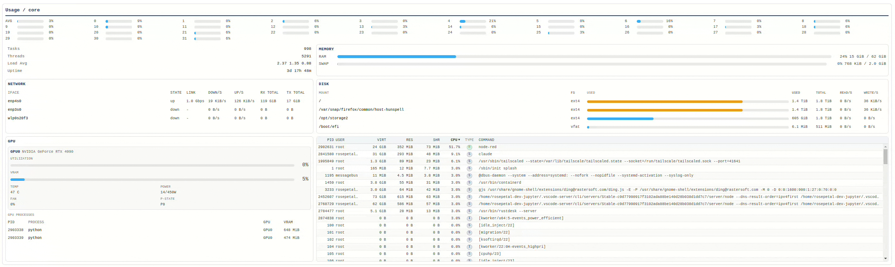

# System Monitor Widget for Node-RED Dashboard 2

`@rosepetal/node-red-dashboard-2-system-monitor` provides 1 widget for Node-RED Dashboard 2 that shows the CPU, memory, disk, network, NVIDIA GPU and process metrics of the Linux host where Node-RED runs.



## Installation

```bash
cd ~/.node-red
npm install @rosepetal/node-red-dashboard-2-system-monitor
```

Or search `@rosepetal/node-red-dashboard-2-system-monitor` in the Node-RED Palette Manager.

The npm package is not named after the repository: the repository is `node-red-contrib-system-monitor`, the package is `@rosepetal/node-red-dashboard-2-system-monitor`.

## Requirements

- Node.js: a version supported by your Node-RED; the usage figures of the disk panel need Node.js >= 18.15 (`fs.statfs`)
- Node-RED Dashboard 2 (`@flowfuse/node-red-dashboard`) in the same Node-RED; the package does not declare it as a dependency, so install it as well
- Node-RED >= 3.0.0, the minimum of Dashboard 2 (the package itself declares >= 1.0.0)
- Linux: the metrics are read from `/proc` and `/sys/class/net`
- `nvidia-smi` in the `PATH` *(optional, for the GPU panel)*

## Nodes

The package registers one node, of type `ui-system-monitor`. It appears as **system-monitor** under the **dashboard** category in the editor.

| Node | Purpose |
|------|---------|
| **[system-monitor](./system-monitor.md)** | Display-only Dashboard 2 widget with six panels: CPU, memory, disk, network, GPU and processes |

## Quick start

1. Add a **system-monitor** node to a flow. It has no inputs and no outputs, so it is not wired to anything.
2. In its edit dialog choose the Dashboard 2 **Group** that shows the widget (required). **Size** and **Update interval (ms)** can stay as they are: the interval is 1000 ms by default and 250 ms is the minimum.
3. Deploy and open the dashboard.

The **Name** of the node is the title of the widget; without a name the title is `Usage / core`. See [Configuration](./system-monitor.md#configuration) for every field.

## What it shows

| Panel | Contents |
|-------|----------|
| **CPU** | Usage bar per logical core and the average, tasks, threads, load average, uptime |
| **Memory** | RAM and swap usage bars with used and total values |
| **Disk** | Mountpoint, filesystem, usage bar, used and total bytes, read/s and write/s |
| **Network** | Interface state, link capacity, down/s and up/s, received and transmitted totals |
| **GPU** | Per NVIDIA GPU: utilization, VRAM usage, temperature, power, fan and P-state, plus the VRAM of each GPU process |
| **Processes** | htop-style table with PID, user, VIRT, RES, SHR, CPU, state and command, sortable by VIRT, RES, SHR or CPU |

- Without `nvidia-smi` the GPU panel shows `GPU metrics unavailable` and the other panels work as usual.
- The network panel leaves out `lo` and the interfaces named like virtual ones (`docker0`, `veth*`, `br-*`, `virbr*`, `tun*`, `tap*` and similar).
- The disk panel lists the filesystems mounted from a device under `/dev/`, without pseudo filesystems, snap mounts and loop devices.
- The process table holds the union of the top 50 processes by VIRT, by RES, by SHR and by CPU, not every process.

See [Panels](./system-monitor.md#panels) for the columns of each panel and [Troubleshooting](./system-monitor.md#troubleshooting) for common problems.

## License

Apache-2.0. The package is published on npm as [`@rosepetal/node-red-dashboard-2-system-monitor`](https://www.npmjs.com/package/@rosepetal/node-red-dashboard-2-system-monitor).
