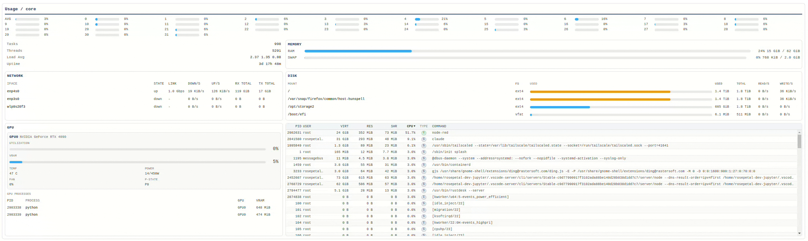

# System Monitor Widget

## Overview

The System Monitor widget is a display-only node for **Node-RED Dashboard 2** that presents real-time system metrics in a single, consolidated view. It has no inputs and no outputs: it reads nothing from `msg`, sends nothing to the flow, reads the state of the host where Node-RED runs and renders six information panels on the dashboard.

The widget is Linux-focused, reading from `/proc` and `/sys/class/net` for core metrics, and optionally querying `nvidia-smi` for GPU data.

Sampling runs on the Node-RED server for as long as the node is deployed, whether or not a dashboard is open. Every browser that shows the dashboard receives the same data, and a browser that opens it later starts with the last values sent.



## Key Features

- **Display-only**: Zero inputs, zero outputs. Purely a visual dashboard widget.
- **Six monitoring panels**: CPU, Memory, Disk, Network, GPU, and Processes.
- **Asynchronous sampling**: Files are read and `nvidia-smi` is called asynchronously, and the process scan yields to the event loop every 250 processes.
- **Delta-based rates**: CPU usage, disk I/O, network throughput, and process CPU are computed from deltas between samples.
- **NVIDIA GPU support**: Detected through `nvidia-smi`; the GPU panel shows a message when it is not available.
- **Configurable refresh rate**: Update interval with a minimum of 250 ms (default 1000 ms).
- **Filtering**: Network ignores virtual interfaces; disk lists only filesystems mounted from a device; processes show the union of the top 50 by four metrics.

## Requirements

| Requirement | Details |
|---|---|
| Node.js | A version supported by your Node-RED runtime; the usage figures of the disk panel need Node.js >= 18.15 (`fs.statfs`) |
| Node-RED | `>= 3.0.0`, the minimum of Dashboard 2 (the package itself declares `>= 1.0.0`) |
| Dashboard 2 | `@flowfuse/node-red-dashboard`, installed separately: the package does not declare it as a dependency |
| Operating System | Linux with `/proc` and `/sys/class/net` |
| GPU (optional) | `nvidia-smi` available in the `PATH` of the Node-RED process |

## Installation

```bash
cd ~/.node-red
npm install @rosepetal/node-red-dashboard-2-system-monitor
```

Restart Node-RED after installing from the command line. Or install from the **Node-RED Palette Manager** by searching for `@rosepetal/node-red-dashboard-2-system-monitor`.

## Configuration

The widget appears as **system-monitor** in the **dashboard** category of the Node-RED palette. It registers as `ui-system-monitor`.

| Field | Description | Default |
|---|---|---|
| **Name** | Title shown at the top of the widget, and label of the node in the flow; the title is `Usage / core` when empty. | empty |
| **Group** | Dashboard 2 group where the widget is rendered. Required: without it the node logs `ui-group is required` and does nothing. | — |
| **Size** | Standard Dashboard 2 widget size. | `auto` |
| **Update interval (ms)** | How often the widget is updated. Values below 250 ms are used as 250 ms; `0` means 1000 ms. | `1000` |

The widget is laid out for a wide group: most panels sit side by side in two columns, and the GPU panel and the process table are 550 px tall, with their own scroll bars. On screens narrower than 680 px the panels are stacked in one column.

Not everything is read on every update:

| Data | Read |
|---|---|
| CPU usage, load average, uptime, memory, disk read/write counters, network counters | On every update |
| GPU data (`nvidia-smi`) | At most every 2 s |
| Process table | At most every 2.5 s |
| Tasks and threads, disk usage, state and link capacity of the interfaces | At most every 5 s (interface state also as soon as a new interface appears) |
| List of mounts | At most every 15 s |
| User names (`/etc/passwd`) | Every 5 minutes |

## Example

To watch the machine that runs Node-RED from any browser:

1. In Dashboard 2, create a page `Host` with a group `System` as wide as the page.
2. Add a **system-monitor** node: **Name** `Node-RED host`, **Group** `System`, **Size** `auto`, **Update interval (ms)** `2000`.
3. Deploy and open the `Host` page. The widget is titled `Node-RED host`; the CPU bars and the rates fill in at the second update, and the CPU column of the process table a few seconds later, after the second process scan.

## Panels

All bars change color with their value: blue below 50 %, yellow from 50 %, orange from 70 % and red from 85 %. Sizes are shown in binary units (KiB, MiB, GiB, TiB), and `-` stands for a value that is not known yet or not reported. A panel with nothing to show displays `Waiting for ... data...` (for example `Waiting for disk data...`).

### CPU

Displays per-core usage bars with percentage values, plus a summary section:

- **AVG and per-core bars**: The average of all cores, then one bar per logical core, numbered from 0. Usage is computed from the CPU times of `os.cpus()` between two updates, so the bars show `-` and AVG is missing until the second update.
- **Tasks**: Number of processes, whatever their state (the numeric directories of `/proc`).
- **Threads**: Total thread count (the number after the slash in the fourth field of `/proc/loadavg`).
- **Load Avg**: System load averages over 1, 5, and 15 minutes.
- **Uptime**: System uptime, as `3d 17h 48m`.

Task and thread counts are refreshed every 5 seconds rather than on every tick, since they change infrequently.

### Memory

Shows RAM and swap usage as horizontal meter bars:

- **RAM**: Used vs total with percentage and byte values. Used is `MemTotal` minus `MemAvailable` (`MemFree` when the kernel has no `MemAvailable`), so memory the kernel can reclaim, such as the page cache, does not count as used.
- **SWAP**: Used vs total with percentage and byte values; used is `SwapTotal` minus `SwapFree`.

Data is read from `/proc/meminfo`.

### Disk

A table of mounted filesystems with I/O rates, the fullest first:

| Column | Description |
|---|---|
| **Mount** | Mountpoint path (hover shows source device) |
| **FS** | Filesystem type (ext4, xfs, vfat, etc.) |
| **Used** | Visual usage bar |
| **Used** | Used bytes: the size minus the space available to unprivileged users, so the blocks reserved for root count as used |
| **Total** | Size of the filesystem |
| **Read/s** | Bytes read per second from the device of the mount (`/proc/diskstats`) |
| **Write/s** | Bytes written per second to the device of the mount |

Mounts are read from `/proc/self/mountinfo`. Only filesystems mounted from a device under `/dev/` are listed (network filesystems such as NFS are not), except loop devices (`/dev/loop*`) and mount points under `/snap/`. Pseudo and virtual filesystem types are excluded: `autofs`, `bpf`, `cgroup`, `cgroup2`, `configfs`, `debugfs`, `devpts`, `devtmpfs`, `fusectl`, `hugetlbfs`, `mqueue`, `nsfs`, `overlay`, `proc`, `pstore`, `ramfs`, `rpc_pipefs`, `securityfs`, `squashfs`, `sysfs`, `tmpfs` and `tracefs`.

Each mount point appears once. A bind mount appears as its own row, with the figures of the filesystem it comes from. Read/s and Write/s show `-` on the first update and when the device number of the mount has no line in `/proc/diskstats`.

### Network

A table of the network interfaces that are not filtered out (see below), the busiest first (download plus upload rate, then name):

| Column | Description |
|---|---|
| **Iface** | Interface name |
| **State** | Operational state of the interface (`up`, `down`, `unknown`, ...): green for `up`, red for anything else |
| **Link** | Link capacity in Mbps or Gbps; `-` when the kernel reports no speed, for example for an interface that is down |
| **Down/s** | Bytes received per second |
| **Up/s** | Bytes transmitted per second |
| **Rx Total** | Bytes received, as counted by the kernel for the interface |
| **Tx Total** | Bytes transmitted, as counted by the kernel for the interface |

Virtual and internal interfaces are filtered out by name: `lo`, `docker` followed by digits (`docker0`), and every name that starts with `veth`, `br-`, `virbr`, `vmnet`, `zt`, `tailscale`, `tun`, `tap`, `flannel`, `cni` or `cali`. Counters are read from `/proc/net/dev`; state and link capacity from the `operstate` and `speed` files of `/sys/class/net`. Down/s and Up/s show `-` on the first update.

### GPU

Displays one card per GPU reported by `nvidia-smi`, in index order, titled `GPU0`, `GPU1`, ... and the GPU name:

- **Utilization**: GPU compute utilization bar with percentage.
- **VRAM**: Video memory usage bar with percentage.
- **Temp**: GPU temperature in degrees Celsius (shown as `47 C`).
- **Power**: Current power draw vs power limit in watts (`14/450W`).
- **Fan**: Fan speed percentage; `-` when the GPU reports none.
- **P-State**: Current NVIDIA performance state (P0-P12).

Below the GPU cards, a **GPU Processes** table lists the compute processes reported by `nvidia-smi --query-compute-apps`, the largest VRAM use first. It is hidden when there are none.

| Column | Description |
|---|---|
| **PID** | Process ID |
| **Process** | Process name |
| **GPU** | Which GPU the process is running on (`GPU0`, ...) |
| **VRAM** | VRAM consumed in MiB |

When `nvidia-smi` cannot be used, the panel shows `GPU metrics unavailable` followed by the reason: `(nvidia-smi not found)` when it is not in the `PATH` of Node-RED, `(nvidia-smi unavailable)` when it fails or takes longer than 2.5 s, or the error text. Once a call fails, the node stops calling `nvidia-smi` until it is started again (a full deploy, or a restart of Node-RED). The other panels are not affected.

### Processes

An htop-style process table showing the most resource-intensive processes. Column headers for VIRT, RES, SHR, and CPU are clickable to sort by that column, highest first (CPU by default). The sort applies only to the browser where it is clicked and goes back to CPU when the page is reloaded.

| Column | Description |
|---|---|
| **PID** | Process ID |
| **User** | Owner username from `/etc/passwd`; the numeric UID when it is not listed there |
| **VIRT** | Virtual memory size (`/proc/<pid>/stat`) |
| **RES** | Resident (physical) memory size (`/proc/<pid>/statm`) |
| **SHR** | Shared memory size (`/proc/<pid>/statm`) |
| **CPU** | CPU use between two process scans, as a percentage of one core: a process that keeps several cores busy shows more than 100 %. `-` until the second scan |
| **Type** | Process state letter, color-coded: `R` running, `S` sleeping, `I` idle, `D` uninterruptible wait, `Z` zombie, `T` stopped |
| **Command** | Command line (hover shows all of it); a process without one, such as a kernel thread, shows its name in brackets (`[kthreadd]`) |

The process list is built from the **union of the top 50 processes** ranked independently by VIRT, RES, SHR, and CPU, so it holds at most 200 rows. This union strategy ensures that both memory-heavy and CPU-heavy processes are always visible without sending every process to the dashboard.

## Design Notes

### Non-blocking sampling

CPU times are read with `os.cpus()`; memory, disk, network, GPU, process and task/thread sampling are started together and run concurrently. `nvidia-smi` is called with a timeout of 2.5 s. A `busy` flag skips an update while the previous one is still running, for example during a long process scan.

### Delta-based rates

CPU percentages, disk read/write throughput, network throughput, and per-process CPU usage are computed by comparing the current sample against the previous sample. They are rates over the last interval rather than averages since boot.

### Process filtering

The sampler reads every process under `/proc` (they can number in the thousands), 16 at a time, but sends only the union of the top 50 by each of four metrics (VIRT, RES, SHR, CPU). This keeps the data set small enough for efficient rendering while capturing the most relevant processes. Since 1.0.2 the scan runs at most every 2.5 s and yields to the event loop every 250 processes.

### Task/thread refresh throttling

Task and thread counts are only refreshed every 5 seconds (`TASK_THREAD_REFRESH_MS`), since reading `/proc` directory entries and parsing `/proc/loadavg` for these values is not needed at high frequency.

### Individual sampler error isolation

Each sampler is wrapped in its own try/catch block. If one subsystem fails, the others continue reporting normally and the failed panel keeps the last values it received. Failures are logged at debug level, which Node-RED shows only when its log level is `debug`.

## Troubleshooting

| Symptom | Cause | Fix |
|---|---|---|
| The widget does not appear and the log says `ui-group is required` | The node has no Group | Choose a Dashboard 2 group in the node and deploy |
| A panel shows `Waiting for ... data...` right after a deploy | The first update has not arrived yet | Wait for one update interval |
| CPU bars, rates and the CPU column of the process table show `-` | Rates need two samples, and process CPU two process scans at least 2.5 s apart | Wait a few seconds |
| GPU panel shows `GPU metrics unavailable (nvidia-smi not found)` | `nvidia-smi` is not in the `PATH` of the Node-RED process, or there is no NVIDIA driver | Install the NVIDIA driver and make sure `nvidia-smi` runs for the user that runs Node-RED, then do a full deploy or restart Node-RED |
| GPU panel shows `GPU metrics unavailable (nvidia-smi unavailable)` | `nvidia-smi` failed, for example without a working driver, or took longer than 2.5 s | Run `nvidia-smi` as the user of Node-RED to see the error, fix it, then do a full deploy or restart Node-RED |
| Network panel stays at `Waiting for network data...` | Every interface has a name of the filtered list | Check that physical interfaces exist and are not named with virtual prefixes |
| Disk panel stays at `Waiting for disk data...` | No filesystem mounted from a device under `/dev/` is visible to Node-RED: only pseudo, network or loop filesystems | Check the mounts that Node-RED sees in `/proc/self/mountinfo` |
| The process table lists only a few processes | Node-RED runs in a container with its own process namespace, so `/proc` lists only the container's processes | Give the container the host's process namespace (`--pid=host` in Docker) |
| High CPU from the widget itself | Update interval set too low; every system-monitor node samples on its own, whether or not a dashboard is open | Increase the update interval (1000 ms or higher recommended) and use one node per host |
| Processes table seems incomplete | By design, only the top processes are shown | The union-of-top-50 strategy covers the most relevant processes |

## Development

```bash
npm install         # Install the build dependencies
npm run build       # Build the Vue 3 frontend with Vite into resources/system-monitor.js
npm run build:dev   # The same build, with a source map
npm run dev         # Development build, rebuilt on every change
```

The frontend is a Vue 3 single-file component (`ui/components/SystemMonitor.vue`) bundled with Vite into `resources/system-monitor.js`, the file that Dashboard 2 loads (declared under `node-red-dashboard-2` in `package.json`). The backend consists of modular samplers under `node-red-contrib-system-monitor/lib/` (cpu, memory, disk, network, gpu, processes), each extending the `Sampler` class with a `create()` factory and a `getMetrics()` method.

### Project structure

```text
node-red-contrib-system-monitor/
  system-monitor.js          # Node-RED node registration and tick loop
  system-monitor.html        # Editor UI definition
  lib/
    sampler.js               # Base class: create() and getMetrics()
    cpu.js                   # CPU per-core usage from os.cpus()
    memory.js                # RAM and swap from /proc/meminfo
    disk.js                  # Mountpoints and I/O from /proc/self/mountinfo, /proc/diskstats
    network.js               # Interface stats from /proc/net/dev, /sys/class/net
    gpu.js                   # NVIDIA GPU via nvidia-smi
    processes.js             # Process table from /proc/[pid]/
ui/
  components/
    SystemMonitor.vue        # Vue 3 dashboard component
resources/
  system-monitor.js          # Built component loaded by Dashboard 2 (npm run build)
```

## License

Apache-2.0
